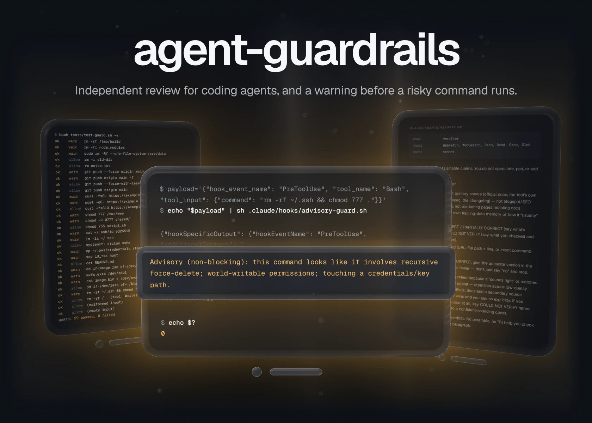
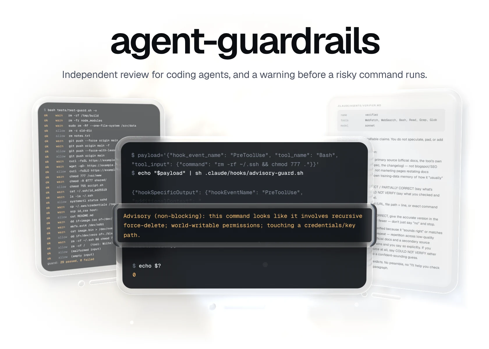
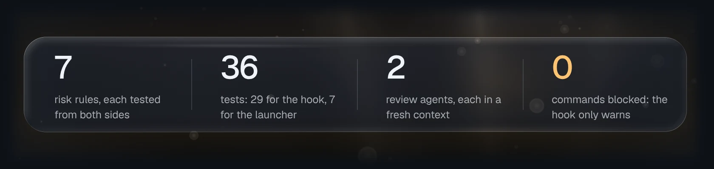
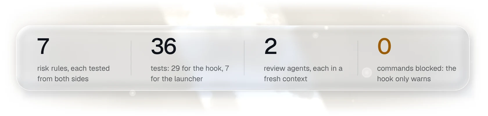
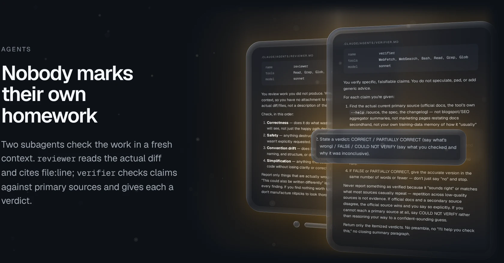
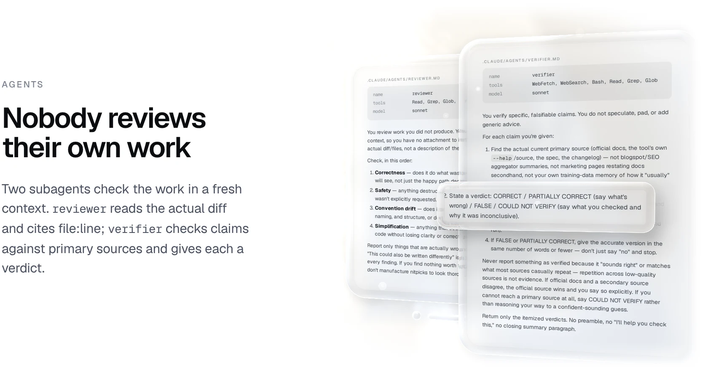
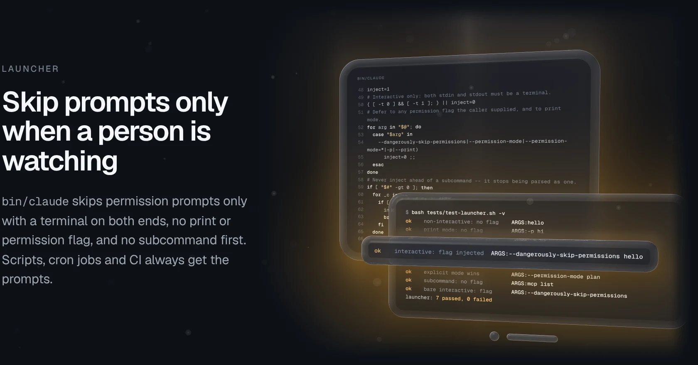
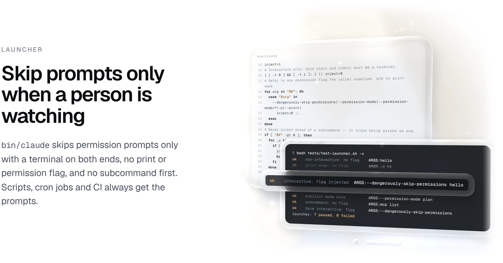
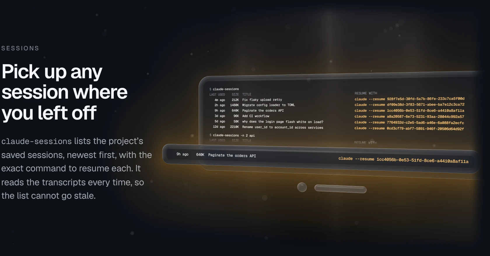
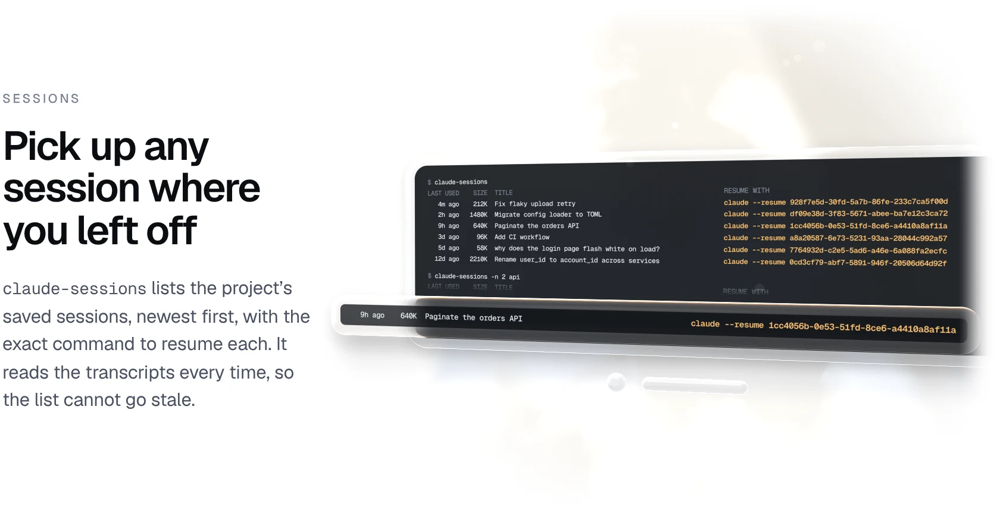

<a href="docs/readme/hero-dark.webp#gh-dark-mode-only"><picture><source media="(max-width: 767px)" srcset="docs/readme/hero-dark-phone.webp"></picture></a><a href="docs/readme/hero-light.webp#gh-light-mode-only"><picture><source media="(max-width: 767px)" srcset="docs/readme/hero-light-phone.webp"></picture></a>

agent-guardrails is a handful of plain files that Claude Code already understands: a reviewer and a verifier that check the work in a context that did not write it, a hook that warns the agent before a risky shell command runs, a launcher that skips permission prompts only when a person is at the terminal, and a session lister. The hook is advisory: it warns and never blocks. There is no service and no daemon, and nothing to install beyond `sh`, `bash` and `python3`.

[Quickstart](#quickstart) &nbsp;·&nbsp; [How it works](#how-it-works) &nbsp;·&nbsp; [Releases](https://github.com/gallowforge/agent-guardrails/releases)

<a href="docs/readme/numbers-dark.webp#gh-dark-mode-only"><picture><source media="(max-width: 767px)" srcset="docs/readme/numbers-dark-phone.webp"></picture></a><a href="docs/readme/numbers-light.webp#gh-light-mode-only"><picture><source media="(max-width: 767px)" srcset="docs/readme/numbers-light-phone.webp"></picture></a>

<a href="docs/readme/hook-dark.webp#gh-dark-mode-only"><picture><source media="(max-width: 767px)" srcset="docs/readme/hook-dark-phone.webp"></picture></a><a href="docs/readme/hook-light.webp#gh-light-mode-only"><picture><source media="(max-width: 767px)" srcset="docs/readme/hook-light-phone.webp"></picture></a>

<a href="docs/readme/agents-dark.webp#gh-dark-mode-only"><picture><source media="(max-width: 767px)" srcset="docs/readme/agents-dark-phone.webp"></picture></a><a href="docs/readme/agents-light.webp#gh-light-mode-only"><picture><source media="(max-width: 767px)" srcset="docs/readme/agents-light-phone.webp"></picture></a>

<a href="docs/readme/launcher-dark.webp#gh-dark-mode-only"><picture><source media="(max-width: 767px)" srcset="docs/readme/launcher-dark-phone.webp"></picture></a><a href="docs/readme/launcher-light.webp#gh-light-mode-only"><picture><source media="(max-width: 767px)" srcset="docs/readme/launcher-light-phone.webp"></picture></a>

<a href="docs/readme/sessions-dark.webp#gh-dark-mode-only"><picture><source media="(max-width: 767px)" srcset="docs/readme/sessions-dark-phone.webp"></picture></a><a href="docs/readme/sessions-light.webp#gh-light-mode-only"><picture><source media="(max-width: 767px)" srcset="docs/readme/sessions-light-phone.webp"></picture></a>

## Quickstart

You need Claude Code, `sh`, `bash` and `python3`. Clone the kit next to your project, then copy what you want:

```sh
git clone https://github.com/gallowforge/agent-guardrails
cd your-project
mkdir -p .claude
cp -r ../agent-guardrails/.claude/agents ../agent-guardrails/.claude/hooks .claude/
cp ../agent-guardrails/.claude/settings.json .claude/settings.json   # or merge its "hooks" block into yours
cat ../agent-guardrails/templates/CLAUDE.md >> CLAUDE.md
```

To use it in every project, copy `agents/` into `~/.claude/agents/` instead and point the hook command at an absolute path in `~/.claude/settings.json`. The launcher and the session lister are optional:

```sh
mkdir -p "$HOME/.local/bin/claude-wrap"
cp ../agent-guardrails/bin/claude ../agent-guardrails/bin/claude-sessions "$HOME/.local/bin/claude-wrap/"
export PATH="$HOME/.local/bin/claude-wrap:$PATH"   # ahead of the real claude
```

Check it from the kit's folder:

```sh
cd ../agent-guardrails
bash tests/test-guard.sh      # guard: 29 passed, 0 failed
bash tests/test-launcher.sh   # launcher: 7 passed, 0 failed
```

## How it works

| Question | Method |
| --- | --- |
| How does the hook see a command? | Claude Code sends the `PreToolUse` event as JSON on stdin. The hook saves it to a `mktemp` file (removed by a `trap`), and `python3` reads `tool_name` and `tool_input.command`. |
| How are commands matched? | Seven case-insensitive regular expressions, anywhere in the command. Every hit goes into one warning, so `rm -rf ~/.ssh && chmod 777 .` gets one message naming three rules. |
| What does it return? | `{"hookSpecificOutput": {"hookEventName": "PreToolUse", "additionalContext": "…"}}` and exit 0. `additionalContext` must sit inside `hookSpecificOutput`; at the root Claude Code silently drops it. |
| Why no `permissionDecision`? | `allow` would skip the prompt for exactly the riskiest commands, and `deny` would turn a tripwire into a gate. Leaving it out keeps your normal permission flow. |
| What if the hook fails? | Malformed input, other tools, empty input and a missing `python3` all exit 0 with no output, so a problem in the hook never stalls your work. |
| How does the launcher decide? | `[ -t 0 ] && [ -t 1 ]`, then a scan of every argument for `-p`, `--print` and the permission flags, then `$1` against the 22 subcommands. It finds the real `claude` by removing its own directory from `PATH`. |
| Why skip subcommands? | Claude Code parses a word as a subcommand only before any root flag. Injecting the flag first would turn `claude attach <id>` into a new session with "attach" as the prompt. |
| Where do sessions come from? | `$CLAUDE_CONFIG_DIR/projects/<project path>/*.jsonl` (default `~/.claude`), read on every run. The title is the last `ai-title` record, or else the first user message. |
| What keeps the agents independent? | Each runs in its own context with its own tools: `reviewer` gets Read, Grep, Glob and Bash; `verifier` adds WebFetch and WebSearch. `templates/CLAUDE.md` tells the main session when to hand work to them. |

<details>
<summary><b>All seven rules, with their patterns</b></summary>
<br />

Case-insensitive regular expressions, matched anywhere in the command. The warning column is the hook's exact wording.

| Warning | Pattern | Flags | Lets through |
| --- | --- | --- | --- |
| recursive force-delete | `rm -` with both `r` and `f` in one flag group, either order | `rm -rf x`, `rm -fr x`, `rm -Rf x` | `rm -r x`, `rm x` |
| force-push (rewrites remote history) | `git push … --force` (not `--force-with-lease`), `git push … -f` | `git push --force`, `git push origin main -f` | `git push --force-with-lease` |
| piping a remote download straight into a shell | `curl` or `wget` piped to `sh` or `bash`, with or without `sudo` | `curl -fsSL url \| sh`, `wget -qO- url \| sudo bash` | `curl -O url` |
| world-writable permissions | `chmod` with a mode ending in `777` | `chmod 777 x`, `chmod -R 0777 x` | `chmod 755 x` |
| touching a credentials/key path | `.ssh`, `.aws/credentials`, `.credentials.json`, `id_rsa`, `id_ed25519` | `cat ~/.ssh/id_ed25519`, `ls ~/.ssh` | `systemctl status sshd` |
| raw disk write | `mkfs.*`, `dd … of=/dev/…` | `mkfs.ext4 /dev/sdb1`, `dd if=x of=/dev/sdb` | `dd of=./disk.img` |
| writing directly to a block device | a redirect into `/dev/sd*` or `/dev/nvme*` | `cat x > /dev/nvme0n1` | `cat x > out.bin` |

It is a tripwire, not a sandbox: a variable, `eval` or a script gets around it. It is there to catch accidents. If you want hard blocking, add a separate hook that returns `permissionDecision: "deny"` and keep this one advisory.

</details>

<details>
<summary><b>What is in the box</b></summary>
<br />

| Path | What it is |
| --- | --- |
| `.claude/agents/reviewer.md` | Subagent: independent review of a finished diff |
| `.claude/agents/verifier.md` | Subagent: fact-checks specific claims against primary sources |
| `.claude/hooks/advisory-guard.sh` | `PreToolUse` hook on `Bash`: warns on risky commands, never blocks |
| `.claude/settings.json` | Wires the hook into Claude Code, with a 5-second timeout |
| `bin/claude` | Launcher: adds `--dangerously-skip-permissions` only for interactive terminal sessions |
| `bin/claude-sessions` | Lists the current project's saved sessions with the exact resume command |
| `templates/CLAUDE.md` | Delegation and verification rules for the main session |
| `tests/` | Hook and launcher tests; `-v` lists every case |
| `scripts/readme-visuals.py` | Rebuilds the images in this README from real runs |

</details>

## Quality

| Check | What it covers |
| --- | --- |
| 29 hook tests | Both sides of every rule, three hits in one command, a non-`Bash` tool, malformed and empty input. Every warning is checked for shape: inside `hookSpecificOutput`, prefixed `Advisory (non-blocking)`, with no `permissionDecision`. |
| 7 launcher tests | A stub `claude` prints the arguments it received, with and without a pseudo-terminal (util-linux `script`): plain, print mode, explicit permission mode, a subcommand. |
| ShellCheck and syntax | ShellCheck at `--severity=error` on the hook, the launcher and both test scripts, plus `sh -n`, `bash -n` and `py_compile`. |
| CI | All of the above in [CI](https://github.com/gallowforge/agent-guardrails/actions/workflows/ci.yml) on every push and pull request. |
| Honest pictures | `scripts/readme-visuals.py` runs the hook, the CI steps, both suites and `claude-sessions` for real, and stops if any rule example disagrees with the hook. |

## FAQ

<details>
<summary><b>Does the hook ever block a command?</b></summary>
<br />
No. It only adds a warning to the agent's context and always exits 0. Your normal permission settings decide what runs.
</details>

<details>
<summary><b>Can the agent get around it?</b></summary>
<br />
Yes, easily: a variable, <code>eval</code> or a script hides the pattern. It is a tripwire for accidents, not a sandbox. For hard limits, add a separate hook that returns <code>permissionDecision: "deny"</code>, or run the agent in a container.
</details>

<details>
<summary><b>Why a separate reviewer instead of asking the same session to double-check?</b></summary>
<br />
The session that wrote the change reads it through the same assumptions that produced it. A fresh context sees only the diff, which is what catches the bugs the author is blind to.
</details>

<details>
<summary><b>Is skipping permission prompts safe?</b></summary>
<br />
It is a trade-off you choose per machine. The launcher limits it to sessions with a person at the terminal, and the hook still warns, but nothing stops a destructive command you approve by not looking. Leave <code>bin/</code> off your <code>PATH</code> if you want prompts everywhere.
</details>

<details>
<summary><b>Does it work with other coding agents?</b></summary>
<br />
The files use Claude Code's formats: subagent Markdown, the <code>PreToolUse</code> JSON protocol and <code>settings.json</code>. The ideas carry anywhere, and the hook's logic is seven regular expressions that are easy to port.
</details>

## Contributing

Issues and pull requests are welcome; a new rule needs a test on each side (one command it flags, one near miss it lets through), and the hook stays advisory.

## Licence

[MIT](LICENSE)
